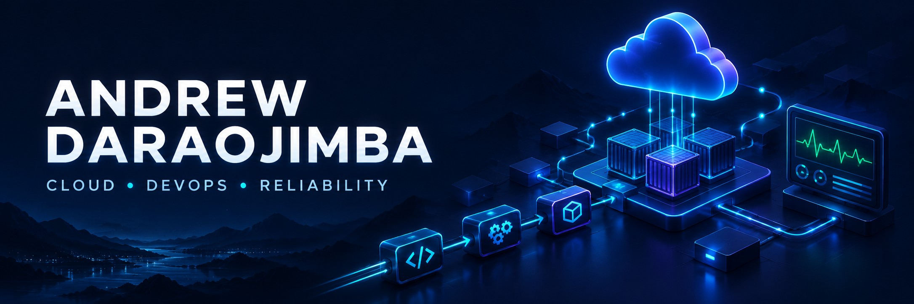

  

<h1 align="center">Hi 👋, I'm Andrew Daraojimba</h1>
<h3 align="center">Cloud & DevOps Engineer · Site Reliability Engineer</h3>

  Building reliable cloud platforms, automating delivery, and making systems easier to operate.

  
  
  

---

### 👨‍💻 A little about me

I'm **Andrew Ifesinachi Daraojimba**, a Cloud and DevOps Engineer based in **Lagos, Nigeria**. I work with AWS and Azure environments, automate infrastructure and delivery workflows, and help keep applications observable and reliable.

- ☁️ **Cloud & infrastructure:** AWS, Azure, Terraform, and Linux.
- 🚀 **Delivery:** GitHub Actions, Docker, Kubernetes, and Amazon EKS.
- 📊 **Observability:** Prometheus, Grafana, and Amazon CloudWatch.
- 🛠️ **Reliability:** troubleshooting, controlled releases, backups, and recovery.
- 🌱 **Growing my practice:** scalability, platform engineering, and resilient cloud architecture.
- 💬 **Ask me about:** infrastructure automation, CI/CD, Kubernetes, and monitoring.

 

### 🧰 Technologies & tools

**Cloud platforms**

**Infrastructure & containers**

**Delivery & security**

**Monitoring & reliability**

### 🚀 Featured DevOps projects

| Project | What you'll find | Core technologies |
| :--- | :--- | :--- |
| [AWS EC2-to-EKS Re-platforming](https://github.com/Lifeofdrew2/aws-eks-platform) | A reference platform for moving a VM-hosted service to EKS, with a multi-AZ network, container registry, and Kubernetes workloads. | AWS · Terraform · EKS · Docker |
| [EKS CI/CD Pipeline](https://github.com/Lifeofdrew2/eks-cicd-pipeline) | Automated testing, image builds, security scans, staging validation, approval gates, and rollback workflows. | GitHub Actions · ECR · EKS · Trivy |
| [EKS Observability Stack](https://github.com/Lifeofdrew2/eks-observability-stack) | Application and infrastructure monitoring, dashboards, SLO-based alerting, and a local Docker Compose setup. | Prometheus · Grafana · Alertmanager · CloudWatch |

These portfolio projects are independent reference implementations using sample applications.

### 🎯 My engineering focus

**Automate repeatable work. Make releases safer. Measure what matters. Design for recovery.**

I'm interested in work where I can improve deployment workflows, strengthen observability, and build cloud systems that scale reliably.

### 🤝 Let's connect

Connect with me on [LinkedIn](https://www.linkedin.com/in/andrew-d-9446951a9/) or reach me by [email](mailto:andrewifesinachidaraojimba@gmail.com).

<i>Always learning. Always building. Always improving.</i>

